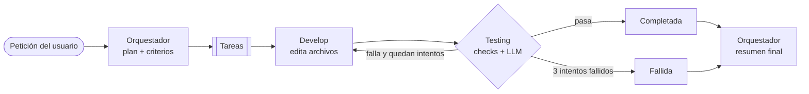
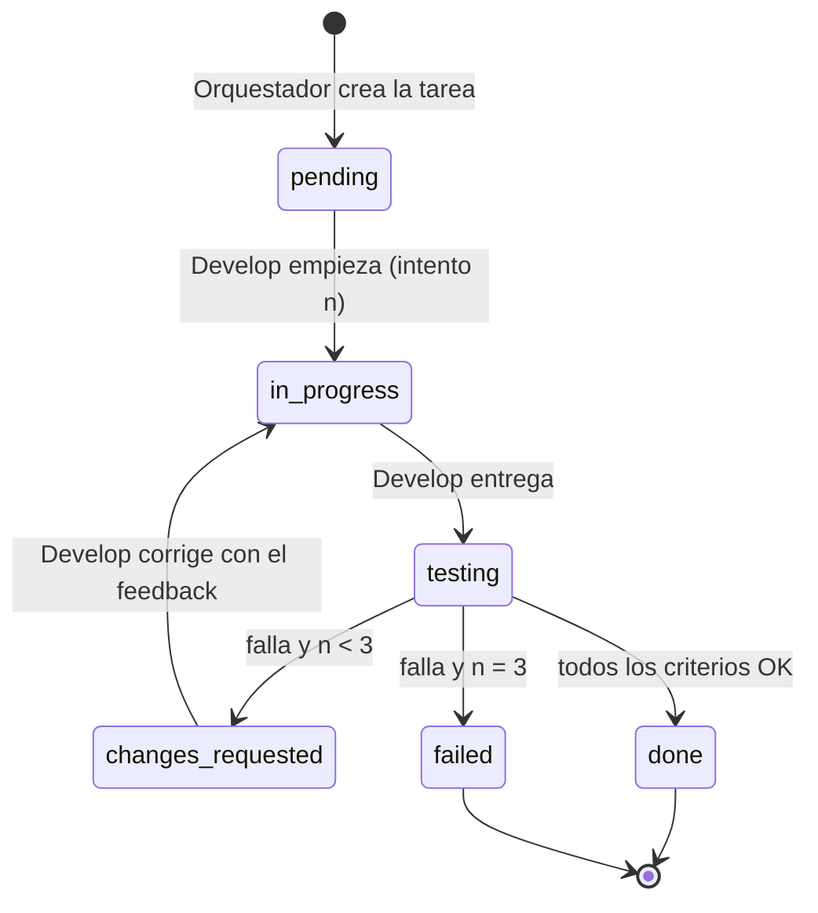

# Agent Team — 3 agentes de IA trabajando a la vista

Prueba técnica para **Speed Paradigm**. Pides un cambio en una web y un equipo de tres agentes lo hace delante de ti:

1. **Orquestador**: divide la petición en tareas con criterios de aceptación verificables.
2. **Develop**: programa cada tarea editando los archivos de la web.
3. **Testing**: comprueba el trabajo (checks automáticos + revisión con LLM) y devuelve lo que falla. Se repite hasta que pasa, con un máximo de 3 intentos por tarea.

En pantalla se ve qué hace cada agente, en qué estado está cada tarea, la timeline de eventos, los archivos que cambian y la web resultante.

**Demo pública:** _pendiente de despliegue — URL de Vercel aquí_

## Documentación

El proceso está documentado desde dos puntos de vista:

- **[docs/claude-code-log.md](docs/claude-code-log.md): el punto de vista de Claude Code.** Claude Code lo fue escribiendo al cerrar cada fase, de la preparación a la entrega. Recoge qué se le pidió, cómo trabajó, qué decisiones tomó y qué errores encontró y corrigió.
- **[docs/documentacionJavier.md](docs/documentacionJavier.md): el punto de vista del programador.** Cuenta cómo trabajé yo con Claude Code: cómo lo guié, qué revisé y qué decidí en cada momento.

Documentación técnica complementaria: [docs/architecture.md](docs/architecture.md) (arquitectura en detalle) y [docs/deploy.md](docs/deploy.md) (checklist de despliegue).

## Cómo funciona

Cada tarea recorre una máquina de estados que se ve como columnas del kanban:

## Stack (todo en plan gratuito, sin tarjeta)

| Pieza | Por qué |
|---|---|
| **Next.js 16** (App Router, TypeScript estricto, Tailwind 4) | Requisito. UI y API en un solo despliegue. |
| **Supabase** (Free) | Postgres para runs, tareas, informes, eventos y el workspace virtual; Realtime para ver a los agentes en directo. |
| **Google Gemini API** (plan gratuito, `gemini-3.5-flash-lite`) | Function calling y 500 peticiones/día. Los Flash grandes solo dan 20/día. |
| **Vercel** (Hobby) | Despliegue de Next.js sin configuración. |
| zod, node-html-parser, Vitest | Validar toda salida del LLM, checks deterministas sobre el HTML y tests. |

Sin frameworks de agentes (LangChain, etc.): el bucle es propio y corto (`src/lib/agents/`).

## Decisiones técnicas

- **Workspace virtual.** Cada run copia una web semilla (una panadería, «Horno Alba»: 3 páginas HTML + CSS + JS) a la tabla `files`. Develop solo puede escribir ahí, con rutas validadas (sin `..`, extensiones permitidas, 100 KB máx.). El resultado se sirve en `/preview/[runId]/` con una CSP restrictiva y en un iframe con `sandbox`.
- **Un paso por petición.** El run es una máquina de estados en BD. `POST /api/runs/[id]/step` ejecuta *una* acción de un agente con un presupuesto de 48 s (la función tiene 60 s en Vercel Hobby) y el navegador va pidiendo pasos. Un lock en BD (`runs.locked_until`) evita dos pasos a la vez. Si se cierra la pestaña, el run queda en su estado y se puede reanudar.
- **Testing en dos capas.** Primero checks deterministas, sin LLM: los criterios de cada tarea (`file_exists`, `selector_exists`, `text_contains`, `link_exists`) más checks globales de toda la web (HTML bien formado, enlaces, CSS, JS e imágenes internos que existen). Después, una revisión con LLM. **Si falla un check determinista, la tarea no pasa**, diga lo que diga el LLM.
- **Tiempo real con respaldo.** Supabase Realtime sobre `runs`, `tasks`, `agent_events` y `test_reports`. Si no conecta en 5 s, polling cada 2 s.
- **Cuidar la cuota gratuita.** Nunca hay llamadas en paralelo; hay un mínimo de 4,5 s entre llamadas y reintentos con backoff que respetan `retry-after`. Develop recibe los archivos relevantes en el prompt y entrega tras escribir, sin peticiones extra. Hay límites de runs por hora (global y por IP hasheada) y un código de acceso opcional.
- **Errores visibles, nunca ocultos.**
  - Si Gemini está saturado (503), el panel muestra una cuenta atrás y reanuda solo.
  - Si se agota la cuota (429), se pausa con un mensaje claro y un botón Reanudar.
  - `LLM_PROVIDER=mock` hace funcionar la demo sin clave ni cuota.

Más detalle en [docs/architecture.md](docs/architecture.md).

## Cómo se construyó con Claude Code

Todo el código, las migraciones, los tests y la documentación los escribió **Claude Code**. El programador revisó cada fase, creó los servicios, ejecutó el SQL e hizo los commits. El registro completo está en [docs/claude-code-log.md](docs/claude-code-log.md); en resumen:

- **Contexto antes que código.** [`CLAUDE.md`](CLAUDE.md) fija las reglas (todo gratis, nada de commits ni despliegues por parte de Claude Code, no leer `.env.local`). Cuatro **skills** en `.claude/skills/` (`motor-agentes`, `base-de-datos`, `panel-ui`, `entrega`) se cargan por área. Se mantienen al día: cuando el código las contradice, se corrigen en el mismo cambio.
- **Fases cortas con puerta de calidad.** Hubo 8 fases (scaffold → BD → checks → agentes → API → UI → pulido → entrega). Cada una se cerraba con `lint`, `typecheck`, `test` y `build` en verde, una entrada en el log y un commit propuesto, y se paraba ahí.
- **Verificación real, no solo tests.**
  - Scripts que comprueban Supabase y el modelo de Gemini sin imprimir claves (`npm run db:check`, `npm run llm:check`).
  - Una CLI que ejecuta el motor sin UI (`npm run demo:cli`).
  - Chrome headless conducido con playwright-core contra el build de producción: lanza runs, simula 503 y 429 y revisa capturas.
- **Depuración por medición.** Los fallos con Gemini real (latencias de 50 s, 429 con cuota aparentemente libre, 503) se investigaron con experimentos que cambiaban una variable cada vez. Así se descubrió que los modelos Flash grandes tienen 20 peticiones al día, que `thinkingLevel` empeora a los Flash-Lite y que los 503 son saturación de Google y no dependen del tamaño del prompt.
