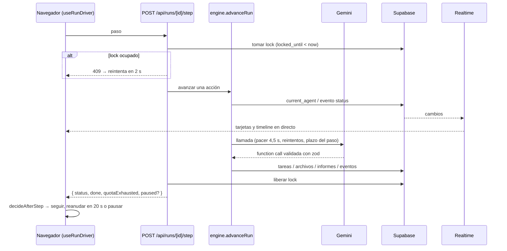

# Arquitectura

Detalle técnico de Agent Team. Para la visión general, ver el [README](../README.md).

## Mapa del código

```
src/
├── app/
│   ├── page.tsx                      Inicio: agentes, formulario, runs recientes
│   ├── runs/[id]/page.tsx            Panel del run (Suspense + RunPanel)
│   ├── not-found.tsx, error.tsx      404 y error boundary en español
│   ├── api/
│   │   ├── runs/route.ts             POST crear run (cuota, código) · GET últimos 20
│   │   ├── runs/[id]/route.ts        GET vista completa del run
│   │   ├── runs/[id]/files/route.ts  GET archivos con contenido
│   │   ├── runs/[id]/step/route.ts   POST un paso del motor (lock, maxDuration 60)
│   │   └── config/route.ts           GET proveedor/modelo y si hace falta código
│   └── preview/[runId]/[[...path]]/  La web del workspace, con CSP
├── components/                       Panel: AgentStrip, TaskBoard, TaskDrawer, Timeline, WorkspacePanel…
├── hooks/
│   ├── useRunRealtime.ts             Estado en vivo: Realtime + polling + resincronización
│   └── useRunDriver.ts               Bucle de pasos del navegador
├── lib/
│   ├── agents/                       Motor (sin React ni Next: se ejecuta también desde la CLI)
│   │   ├── engine.ts                 Máquina de estados: createRun, advanceRun, stepWithLock
│   │   ├── orchestrator.ts           Plan (create_plan) y resumen final
│   │   ├── develop.ts                Bucle de herramientas de Develop
│   │   ├── testing.ts                Veredicto: checks deterministas + LLM
│   │   ├── checks.ts                 Checks deterministas (funciones puras)
│   │   ├── tools.ts                  Herramientas de Develop sobre el workspace
│   │   ├── prompts.ts, limits.ts
│   │   └── store*.ts                 RunStore: Supabase o memoria
│   ├── llm/                          Wrapper LLM: gemini.ts, mock.ts, retry.ts, structured.ts
│   ├── server/                       Cuota, dependencias del motor, vistas (server-only)
│   ├── supabase/                     Clientes (admin, server, browser) y tipos
│   ├── ui/                           Metadatos visuales, formato, driver-policy
│   ├── env.ts                        Variables de entorno validadas con zod
│   └── workspace.ts                  Validación de rutas y escrituras
└── seed/site/                        Web semilla «Horno Alba»
supabase/migrations/                  0001_init.sql, 0002_run_quota.sql
scripts/                              check-db, check-llm, demo-cli, vitest (lanzador)
```

## Modelo de datos (Supabase)

| Tabla | Contenido | Acceso público |
|---|---|---|
| `runs` | Petición, estado (`queued` → `running` → `completed` / `completed_with_errors` / `error`), agente y acción actuales, resúmenes, `locked_until` | Lectura + Realtime |
| `tasks` | Título, descripción, `acceptance_criteria` (jsonb con su `check`), estado, `attempts`, `position` | Lectura + Realtime |
| `test_reports` | Por intento: checks deterministas, veredicto por criterio, `passed`, feedback | Lectura + Realtime |
| `agent_events` | Timeline: agente, tipo (`status` / `thinking` / `action` / `result` / `error`), mensaje, payload (uso de tokens, modelo, motivo de pausa) | Lectura + Realtime |
| `files` | Workspace virtual: `(run_id, path)`, contenido, quién lo tocó | Lectura |
| `run_quota` | Hash de IP y fecha de cada run, para los límites por hora | **Ninguno** (solo `service_role`) |

- **RLS:** lectura pública en las cinco primeras tablas. Todas las escrituras van por el servidor con la clave secreta, que nunca llega al navegador.
- **`run_quota`** existe para que el hash de IP no quede en `runs`, que es legible públicamente (migración 0002).
- Un trigger mantiene `updated_at`.

## Ciclo de vida de un paso



**Qué hace `advanceRun` según el estado:**
- `queued`: el Orquestador planifica (1-6 tareas) y el run pasa a `running`.
- `running`, primera tarea no terminada:
  - `pending` / `changes_requested`: `attempts++` y Develop hace el intento; la tarea pasa a `testing`.
  - `in_progress` (paso interrumpido): Develop repite el mismo intento.
  - `testing`: Testing emite el veredicto y la tarea pasa a `done`, `changes_requested` o `failed` (al tercer intento).
- No quedan tareas: el Orquestador redacta el resumen final y el run pasa a `completed` o `completed_with_errors`.

**Presupuesto de tiempo:** 48 s por paso. Develop no empieza un turno nuevo si quedan menos de 14 s, y Gemini rechaza plazos HTTP menores de 10 s, así que en ese caso no se llama y el run sigue en el paso siguiente.

## Los agentes

Todos usan function calling **forzado** con un esquema JSON generado desde zod (`z.toJSONSchema`). La salida se valida y, si no es válida, se reintenta una vez devolviendo el error al modelo.

| Agente | Entrada | Salida |
|---|---|---|
| Orquestador | Petición + listado de archivos (ruta y primeras líneas) | `create_plan`: resumen + tareas con criterios y `check`. Se pide en formato plano, más fácil para modelos pequeños, y `normalizePlan` lo convierte (descarta rutas peligrosas y corrige checks imposibles, como `selector_exists` sobre un CSS) |
| Develop | Tarea, criterios, feedback del intento anterior y los archivos relevantes (8.000 caracteres, primero los que nombra la tarea) | Herramientas `list_files`, `read_file`, `write_file`, `delete_file`, `finish`. Termina tras el primer turno con escrituras correctas |
| Testing | Tarea, criterios, resultado de los checks deterministas y archivos modificados | `submit_report`: veredicto por criterio + feedback accionable. `passed` final = LLM **y** checks deterministas |

**Checks deterministas** (`checks.ts`):
- **Por criterio:** `file_exists`, `selector_exists` (selectores CSS sobre el HTML), `text_contains` (texto visible, sin `<script>`/`<style>`, normalizado) y `link_exists` (resuelve rutas relativas, anclas y query strings).
- **Globales:** existe `index.html`, el HTML está bien formado y los enlaces, CSS, JS e imágenes internos existen.
- Nunca lanzan una excepción: un selector inválido es un check fallido con su explicación.

## Capa LLM (`src/lib/llm/`)

Interfaz única `LLMProvider.callWithTools()`; los agentes no saben qué proveedor hay detrás.

- **`gemini.ts`** (`@google/genai`):
  - **Ritmo:** mínimo 4,5 s entre llamadas, por debajo de 15 por minuto.
  - **Reintentos:** backoff ante 429 y 5xx, respetando `retryDelay`, sin pasarse del plazo del paso.
  - **Plazo HTTP:** el que quede del paso (máx. 45 s; si quedan menos de 10 s, no se llama).
  - **Razonamiento:** `thinkingLevel: LOW` solo para modelos que no son «lite».
  - **Gemini 3:** reenvía el contenido original de cada turno (`thoughtSignature`).
- **`mock.ts`:** respuestas guionizadas y coherentes con la petición (contacto, testimonios, menú hamburguesa) que fallan a propósito un intento.
- **Errores:**
  - `LLMUnavailableError(quota | overloaded | timeout)`: el run se pausa, no falla.
  - Cualquier otro error: el run termina en `error`, con un evento visible.

| `paused.reason` | Causa | Qué hace la UI |
|---|---|---|
| `overloaded` | 503 / saturación | Cuenta atrás de 20 s y reanuda sola (máx. 3 seguidas) |
| `quota` | 429 | Pausa con el motivo; botón Reanudar |
| `timeout` | Sin tiempo en el paso | Sigue con el paso siguiente |

## Tiempo real

`useRunRealtime(runId)`:
1. **Carga inicial:** `GET /api/runs/[id]`.
2. **Suscripción:** canal Realtime con `postgres_changes` filtrado por `run_id` en cuatro tablas.
3. **Resincronización:** 1 s después de `SUBSCRIBED` y cada 15 s.
4. **Respaldo:** si no conecta en 5 s o se cae, polling cada 2 s.

El driver no da el primer paso hasta que la conexión está lista; si no, se perdían los eventos del primer paso (se detectó con el navegador). Los archivos no van por Realtime: se refrescan cuando llega un evento de Develop.

## Seguridad y cuota

- **Variables de entorno:** validadas con zod (`env.ts`); los errores nombran la variable, nunca su valor. Nada secreto lleva `NEXT_PUBLIC_`.
- **Límites de runs:** `MAX_RUNS_PER_HOUR` (global, 5) y `MAX_RUNS_PER_IP_PER_HOUR` (3), con la IP hasheada con sal, y `DEMO_ACCESS_CODE` opcional. La petición admite de 5 a 1000 caracteres.
- **Vista previa:** se sirve con `Content-Security-Policy: default-src 'self' 'unsafe-inline'; img-src 'self' data:; frame-ancestors 'self'; form-action 'self'` y `nosniff`, dentro de un iframe `sandbox="allow-scripts allow-forms"`. Así el HTML que genera el LLM no puede cargar recursos externos ni acceder a la app.
- **Escrituras de Develop:** solo rutas relativas sin `..`, extensiones permitidas, 100 KB por archivo y no se puede borrar `index.html`.

## Límites (`src/lib/agents/limits.ts`)

| Límite | Valor |
|---|---|
| Tareas por run | 1-6 |
| Intentos por tarea | 3 |
| Turnos de Develop por paso | 6 |
| Presupuesto del paso / `maxDuration` | 48 s / 60 s |
| Lock del paso | 90 s |
| Archivos en el prompt de Develop | 8.000 caracteres |
| Coste típico | 4-8 peticiones al LLM por run de 1-2 tareas (más si hay intentos de corrección) |

## Tests

111 tests con Vitest (`npm test`): checks deterministas, validación de rutas, entorno, reglas de cuota, capa LLM (reintentos, pacer, `thinkingLevel`, plazo mínimo), Develop, la política del driver y el engine completo con el proveedor guionizado: una tarea que falla y luego pasa, otra que agota los 3 intentos, un check determinista que veta el «sí» del LLM, la pausa sin cuota sin gastar intento, el plan inválido y el lock.
